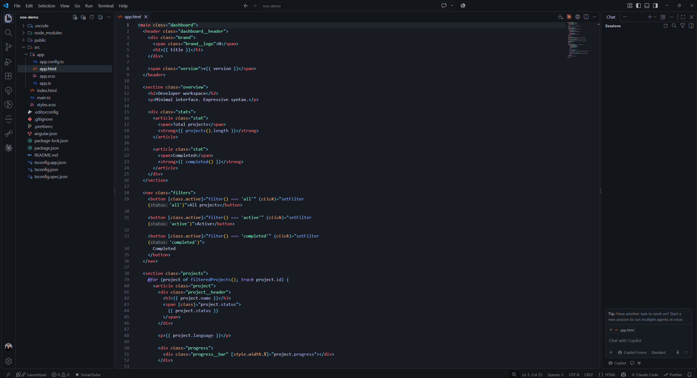
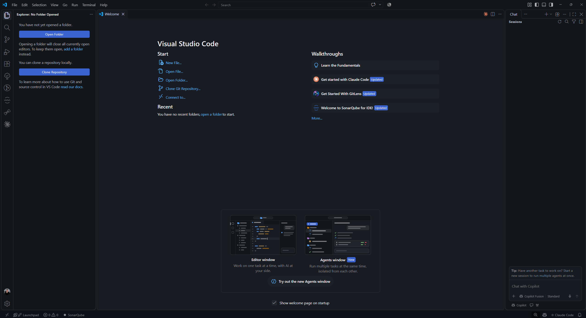

<p align="center">
  
</p>

<h1 align="center">NOX — Graphite</h1>

<p align="center">
  <strong>Minimal interface. Expressive syntax.</strong>
</p>

<p align="center">
  <a href="https://marketplace.visualstudio.com/items?itemName=romezvz.nox-graphite">
    
  </a>
  <a href="https://marketplace.visualstudio.com/items?itemName=romezvz.nox-graphite">
    
  </a>
  <a href="https://marketplace.visualstudio.com/items?itemName=romezvz.nox-graphite">
    
  </a>
  <a href="https://github.com/romezvz/nox-theme/blob/main/LICENSE">
    
  </a>
</p>

<p align="center">
  A minimalist dark theme for Visual Studio Code, designed for a clean,
  balanced and focused development experience.
</p>

<p align="center">
  <a href="https://marketplace.visualstudio.com/items?itemName=romezvz.nox-graphite"><strong>Install from Marketplace</strong></a>
  ·
  <a href="https://github.com/romezvz/nox-theme/releases/latest">Download VSIX</a>
  ·
  <a href="https://github.com/romezvz/nox-theme/issues">Report an issue</a>
</p>

---


## Philosophy

NOX combines a refined graphite interface with expressive syntax highlighting.

Built around simplicity, visual consistency and balanced contrast, NOX reduces
unnecessary visual noise while preserving the personality of your code.

## Features

- Refined graphite interface.
- Expressive and vibrant syntax highlighting.
- Neutral interface typography.
- Subtle borders and visual separation.
- Minimal editor tabs.
- Carefully balanced contrast.
- Italic syntax highlighting.
- Native VS Code theme support.
- No additional runtime dependencies.

## Color palette

### Interface

| Element        | Color     |
| -------------- | --------- |
| Sidebar        | `#12161B` |
| Editor         | `#181C22` |
| Terminal       | `#14181D` |
| Active line    | `#20252C` |
| Selection      | `#303840` |
| Primary text   | `#ECECF1` |
| Secondary text | `#B4B4BC` |
| Muted text     | `#85858D` |

## Syntax previews

### TypeScript


### HTML



### SCSS


### Workbench



## Installation

### Visual Studio Marketplace

1. Open Visual Studio Code.
2. Open the Extensions view (`Ctrl + Shift + X`).
3. Search for **NOX — Graphite** by romezvz.
4. Click **Install**.
5. Select **NOX** from the Color Theme menu.

[View on Visual Studio Marketplace](https://marketplace.visualstudio.com/items?itemName=romezvz.nox-graphite)

### Command line

```bash
code --install-extension romezvz.nox-graphite
```

### Manual installation

1. Download the latest `.vsix` package from [GitHub Releases](https://github.com/romezvz/nox-theme/releases/latest).
2. Open the Command Palette (`Ctrl + Shift + P`).
3. Select `Extensions: Install from VSIX...`.
4. Select the downloaded package.
5. Activate **NOX** from the Color Theme menu.

## Recommended setup

For the complete NOX experience, we recommend:

- [Symbols](https://marketplace.visualstudio.com/items?itemName=miguelsolorio.symbols) file icon theme.
- A programming font with italic support.
- The optional [visual settings preset](https://github.com/romezvz/nox-theme/blob/main/presets/settings.visual.json).

The theme works independently without these recommendations.

## Changelog

See the [CHANGELOG](https://github.com/romezvz/nox-theme/blob/main/CHANGELOG.md) for release history and updates.

## Feedback

Suggestions, improvements and bug reports are welcome.

Please use [GitHub Issues](https://github.com/romezvz/nox-theme/issues) to share your feedback.

If you enjoy using NOX, consider leaving a rating on
[Visual Studio Marketplace](https://marketplace.visualstudio.com/items?itemName=romezvz.nox-graphite&ssr=false#review-details).

## Credits

NOX is based on [Moonlight Italic](https://github.com/atomiks/moonlight-vscode-theme)
by atomiks, preserving its expressive syntax highlighting while introducing
a redesigned workbench interface and an independent visual identity.

## License

Released under the [MIT License](https://github.com/romezvz/nox-theme/blob/main/LICENSE).

---

<p align="center">
  <strong>NOX</strong>
  <br />
  Less noise. More focus.
</p>
