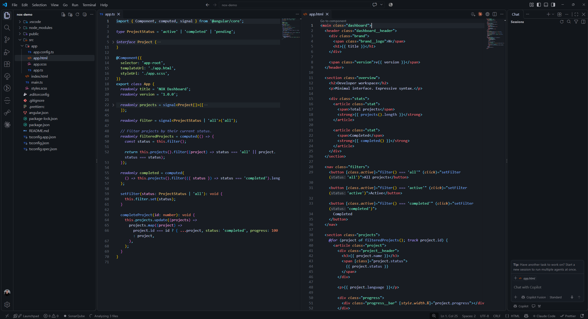
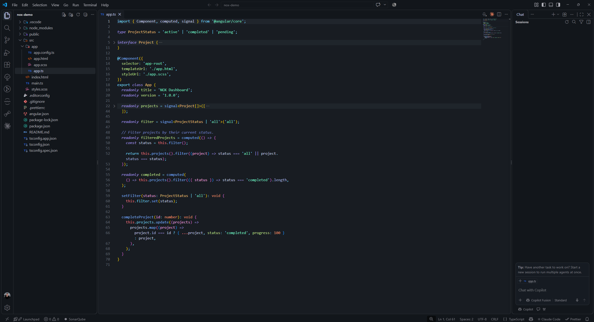
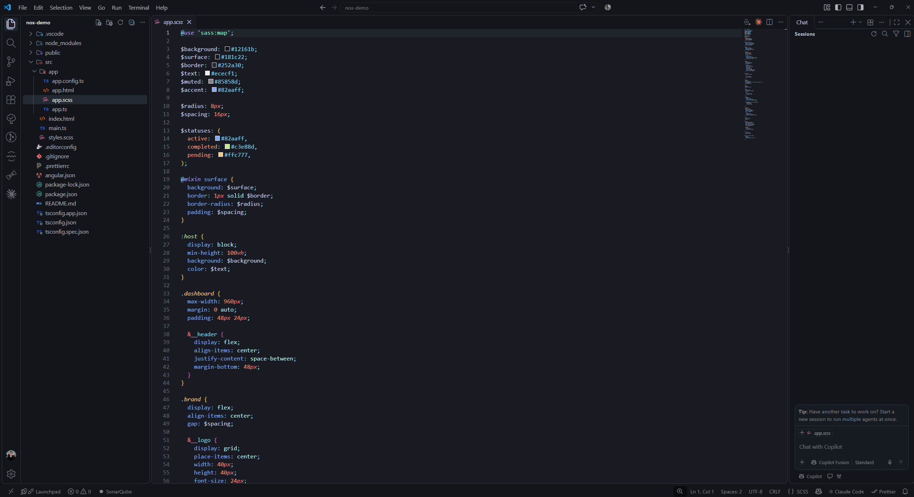

<p align="center">
  
</p>

<h1 align="center">NOX</h1>

<p align="center">
  <strong>Minimal interface. Expressive syntax.</strong>
</p>

<p align="center">
  
  
  
</p>

<p align="center">
  A minimalist dark theme for Visual Studio Code, designed for a clean,
  balanced and focused development experience.
</p>

---



## Philosophy

NOX combines a refined graphite interface with expressive syntax highlighting.

Built around simplicity, visual consistency and balanced contrast, NOX reduces
unnecessary visual noise while preserving the personality of your code.

## Features

- Refined graphite interface.
- Expressive and vibrant syntax highlighting.
- Neutral interface typography.
- Subtle borders and visual separation.
- Minimal editor tabs.
- Carefully balanced contrast.
- Italic syntax highlighting.
- Native VS Code theme support.
- No additional runtime dependencies.

## Color palette

### Interface

| Element        | Color     |
| -------------- | --------- |
| Sidebar        | `#12161B` |
| Editor         | `#181C22` |
| Terminal       | `#14181D` |
| Active line    | `#20252C` |
| Selection      | `#303840` |
| Primary text   | `#ECECF1` |
| Secondary text | `#B4B4BC` |
| Muted text     | `#85858D` |

## Syntax previews

### TypeScript



### HTML


### SCSS



### Workbench


## Installation

1. Download the latest `.vsix` package from [GitHub Releases](https://github.com/romezvz/nox-theme/releases).
2. Open Visual Studio Code.
3. Open the Command Palette using `Ctrl + Shift + P`.
4. Select `Extensions: Install from VSIX...`.
5. Select the downloaded package.
6. Open the Color Theme menu and select **NOX**.

Alternatively, install the extension from your terminal:

```bash
code --install-extension nox-theme-1.0.0.vsix
```

## Recommended setup

For the complete NOX experience, we recommend:

- [Symbols](https://marketplace.visualstudio.com/items?itemName=miguelsolorio.symbols) file icon theme.
- A programming font with italic support.
- The optional [visual settings preset](presets/settings.visual.json).

The theme works independently without these recommendations.

## Feedback

Suggestions, improvements and bug reports are welcome.

Please use [GitHub Issues](https://github.com/romezvz/nox-theme/issues) to share your feedback.

## Credits

NOX is based on [Moonlight Italic](https://github.com/atomiks/moonlight-vscode-theme)
by atomiks, preserving its expressive syntax highlighting while introducing
a redesigned workbench interface and an independent visual identity.

## License

Released under the [MIT License](LICENSE).

---

<p align="center">
  <strong>NOX</strong>
  <br />
  Less noise. More focus.
</p>
